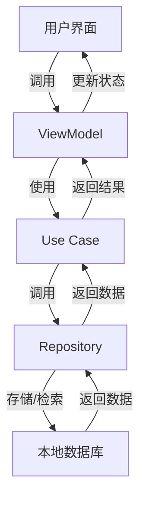

# Alkaa 项目分析报告

## 1. 项目概览

Alkaa 是一个使用 Kotlin 和 Compose Multiplatform 开发的跨平台待办事项应用程序，支持 Android、iOS 和桌面平台。项目名称 "Alkaa" 在芬兰语中意为 "开始"，体现了应用程序帮助用户开始并管理任务的核心功能。

**主要特点：**
- 完全使用 Kotlin 语言开发
- 跨平台 UI 使用 Compose Multiplatform 构建
- 遵循 Material You 设计指南
- 支持多语言（英文、葡萄牙语、西班牙语、法语）
- 提供任务管理、分类、搜索和提醒功能
- 支持自适应布局

**应用场景：**
- 个人任务管理和规划
- 工作项目跟踪
- 日常活动提醒
- 习惯养成追踪

## 2. 目录结构

Alkaa 采用模块化、分层的目录结构，基于六边形架构（Hexagonal Architecture）设计原则。这种架构将应用程序分为不同的层次，核心业务逻辑位于中心，外部依赖指向中心，从而保护核心业务逻辑不受外部变化的影响。

```
├── app/                  # Android 平台特定代码
├── assets/               # 应用资源文件
├── config/               # 构建配置文件
├── data/                 # 数据层模块
│   ├── datastore/        # DataStore 实现
│   ├── local/            # 本地数据库实现
│   └── repository/       # 仓库模式实现
├── desktop-app/          # 桌面平台特定代码
├── docs/                 # 项目文档
├── domain/               # 领域层模块（业务逻辑）
├── features/             # 功能模块
│   ├── alarm/            # 闹钟功能
│   ├── category/         # 分类功能
│   ├── home/             # 主屏幕
│   ├── search/           # 搜索功能
│   └── task/             # 任务功能
├── gradle/               # Gradle 配置
├── ios-app/              # iOS 平台特定代码
├── libraries/            # 项目库模块
├── plugins/              # 构建插件
├── resources/            # 共享资源
└── shared/               # 跨平台共享代码
```

**模块职责：**
- **app/ios-app/desktop-app**：平台特定的应用程序入口点，包含初始化逻辑
- **shared**：所有平台共享的代码，包括 UI 组件和业务逻辑
- **features**：应用程序的功能模块，如任务管理、分类、搜索等
- **domain**：业务逻辑模块，依赖关系仅指向自身
- **data**：数据逻辑模块，处理数据存储和检索
- **libraries**：项目使用的小型库，如设计系统、导航、测试等

## 3. 系统架构与主流程

Alkaa 采用六边形架构（也称为端口和适配器架构），这种架构强调业务逻辑的核心地位，并通过端口和适配器与外部世界交互。

### 架构层次

1. **核心层（Domain）**：
   - 包含业务逻辑和领域模型
   - 定义用例（Use Cases）和仓库接口
   - 不依赖于外部框架或技术

2. **数据层（Data）**：
   - 实现领域层定义的仓库接口
   - 处理数据存储和检索
   - 包含本地数据库、远程API等实现

3. **表示层（Features）**：
   - 实现用户界面和用户交互
   - 调用领域层的用例
   - 使用数据层提供的数据

4. **平台特定层**：
   - 处理平台特定的实现细节
   - 如 Android 的 Activity、iOS 的 UIApplication 等

### 主要数据流



### 核心流程示例

1. **添加任务流程**：
   - 用户在界面上输入任务信息
   - 调用 `AddTask` 用例
   - 用例通过 `TaskRepository` 将任务保存到数据库
   - 数据库返回保存结果
   - 界面更新显示新任务

2. **任务提醒流程**：
   - 用户为任务设置提醒时间
   - 调用 `ScheduleAlarm` 用例
   - 用例根据平台特定实现安排闹钟
   - 到达提醒时间时，系统触发提醒
   - 用户收到任务提醒通知

## 4. 核心功能模块

### 4.1 任务管理

**功能描述**：允许用户创建、编辑、完成和删除任务。

**核心组件**：
- `AddTask`：添加新任务的用例
- `CompleteTask`：标记任务为已完成的用例
- `DeleteTask`：删除任务的用例
- `UpdateTask`：更新任务信息的用例
- `TaskRepository`：任务数据的仓库接口
- `TaskDao`：任务数据库访问对象

**实现细节**：
- 任务数据存储在本地 SQLite 数据库中
- 支持任务标题、描述、截止日期、提醒时间、分类等属性
- 任务状态（已完成/未完成）的管理

### 4.2 任务分类

**功能描述**：允许用户创建和管理任务分类，以便更好地组织任务。

**核心组件**：
- `AddCategory`：添加新分类的用例
- `DeleteCategory`：删除分类的用例
- `LoadCategory`：加载分类的用例
- `UpdateCategory`：更新分类信息的用例
- `CategoryRepository`：分类数据的仓库接口
- `CategoryDao`：分类数据库访问对象

**实现细节**：
- 分类数据存储在本地 SQLite 数据库中
- 每个分类可以有名称和颜色属性
- 任务可以关联到特定分类

### 4.3 任务搜索

**功能描述**：允许用户搜索任务，基于任务标题和描述。

**核心组件**：
- `Search`：搜索功能的表示层组件
- `SearchModule`：搜索功能的依赖注入模块
- `SearchRepository`：搜索数据的仓库接口
- `TaskSearchItem`：搜索结果项模型

**实现细节**：
- 搜索功能在本地数据库上执行
- 支持实时搜索结果更新
- 搜索结果按相关性排序

### 4.4 任务提醒

**功能描述**：允许用户为任务设置提醒，在指定时间收到通知。

**核心组件**：
- `ScheduleAlarm`：安排任务提醒的用例
- `CancelAlarm`：取消任务提醒的用例
- `ShowAlarm`：显示任务提醒的用例
- `SnoozeAlarm`：延迟任务提醒的用例
- `UpdateAlarm`：更新任务提醒的用例

**实现细节**：
- 提醒功能使用平台特定的实现
- Android 使用系统闹钟和通知
- 支持提醒延迟（贪睡）功能

### 4.5 主题设置

**功能描述**：允许用户选择应用程序的主题（浅色、深色或跟随系统）。

**核心组件**：
- `AppViewModel`：管理应用程序状态的视图模型
- `AppThemeOptions`：应用程序主题选项枚举
- `DataStore`：存储用户偏好设置

**实现细节**：
- 主题设置存储在 DataStore 中
- 支持系统主题变化的监听
- Android 平台支持 Material You 动态颜色

## 5. 核心 API/类/函数

### 5.1 AlkaaMultiplatformApp

**功能**：应用程序的主入口点，负责初始化应用程序状态和主题。

**参数**：
- `modifier`：修饰符，用于 UI 定制
- `appState`：应用程序状态，包含导航和 UI 状态

**实现**：
```kotlin
@Composable
fun AlkaaMultiplatformApp(
    modifier: Modifier = Modifier,
    appState: AlkaaAppState = rememberAlkaaAppState(),
) {
    AlkaaTheme(isDarkTheme = rememberIsDarkTheme()) {
        Home(
            appState = appState,
            modifier = modifier,
        )
    }
}
```
<mcfile name="AlkaaMultiplatformApp.kt" path="/Users/zhaojian/code/kmp/alkaa/shared/src/commonMain/kotlin/com/escodro/shared/AlkaaMultiplatformApp.kt"></mcfile>

### 5.2 AddTask

**功能**：添加新任务的用例接口。

**方法**：
- `invoke(task: Task)`：添加指定的任务

**实现**：
```kotlin
interface AddTask {
    suspend operator fun invoke(task: Task)
}
```
<mcfile name="AddTask.kt" path="/Users/zhaojian/code/kmp/alkaa/domain/src/commonMain/kotlin/com/escodro/domain/usecase/task/AddTask.kt"></mcfile>

### 5.3 TaskRepository

**功能**：任务数据的仓库接口，定义了任务数据的操作方法。

**核心方法**：
- `addTask(task: Task)`：添加新任务
- `updateTask(task: Task)`：更新任务
- `deleteTask(taskId: Long)`：删除任务
- `getTask(taskId: Long)`：获取单个任务
- `getAllTasks()`：获取所有任务

### 5.4 Home

**功能**：应用程序的主屏幕，包含底部导航和内容区域。

**参数**：
- `appState`：应用程序状态
- `modifier`：修饰符，用于 UI 定制

**实现**：
```kotlin
@Composable
fun Home(
    appState: AlkaaAppState,
    modifier: Modifier = Modifier,
) {
    HomeLoader(
        appState = appState,
        modifier = modifier,
    )
}
```
<mcfile name="HomeScreen.kt" path="/Users/zhaojian/code/kmp/alkaa/features/home/src/commonMain/kotlin/com/escodro/home/presentation/HomeScreen.kt"></mcfile>

### 5.5 AppViewModel

**功能**：管理应用程序状态的视图模型，如主题设置。

**核心方法**：
- `loadCurrentTheme()`：加载当前主题设置
- `updateTheme(theme: AppThemeOptions)`：更新主题设置

### 5.6 ScheduleAlarm

**功能**：安排任务提醒的用例。

**核心方法**：
- `invoke(task: Task)`：为指定任务安排提醒

### 5.7 CategoryRepository

**功能**：分类数据的仓库接口，定义了分类数据的操作方法。

**核心方法**：
- `addCategory(category: Category)`：添加新分类
- `updateCategory(category: Category)`：更新分类
- `deleteCategory(categoryId: Long)`：删除分类
- `getCategory(categoryId: Long)`：获取单个分类
- `getAllCategories()`：获取所有分类

### 5.8 Search

**功能**：任务搜索功能的表示层组件。

**核心功能**：
- 接收用户搜索输入
- 显示搜索结果
- 处理搜索结果的点击事件

### 5.9 Navigation

**功能**：应用程序的导航组件，处理不同屏幕之间的导航。

**核心功能**：
- 管理导航堆栈
- 处理屏幕之间的跳转
- 支持深层链接

### 5.10 AlkaaTheme

**功能**：应用程序的主题组件，定义了应用程序的视觉风格。

**核心功能**：
- 提供浅色和深色主题
- 支持 Material You 动态颜色（Android）
- 定义应用程序的排版和组件样式

## 6. 技术栈与依赖

| 类别 | 技术/库 | 用途 | 来源 |
|------|---------|------|------|
| 开发语言 | Kotlin | 主要开发语言 | <mcfile name="README.md" path="/Users/zhaojian/code/kmp/alkaa/README.md"></mcfile> |
| UI 框架 | Compose Multiplatform | 跨平台 UI 开发 | <mcfile name="README.md" path="/Users/zhaojian/code/kmp/alkaa/README.md"></mcfile> |
| 导航 | Navigation3 | 屏幕之间的导航 | <mcfile name="README.md" path="/Users/zhaojian/code/kmp/alkaa/README.md"></mcfile> |
| 异步处理 | Coroutines | 异步操作和并发 | <mcfile name="README.md" path="/Users/zhaojian/code/kmp/alkaa/README.md"></mcfile> |
| 依赖注入 | Koin | 依赖管理和注入 | <mcfile name="README.md" path="/Users/zhaojian/code/kmp/alkaa/README.md"></mcfile> |
| 数据库 | SQLDelight | 本地数据存储 | <mcfile name="README.md" path="/Users/zhaojian/code/kmp/alkaa/README.md"></mcfile> |
| 本地存储 | DataStore | 用户偏好设置存储 | <mcfile name="README.md" path="/Users/zhaojian/code/kmp/alkaa/README.md"></mcfile> |
| 设计系统 | Material You | UI 设计指南 | <mcfile name="README.md" path="/Users/zhaojian/code/kmp/alkaa/README.md"></mcfile> |
| 自适应布局 | Compose Adaptive | 不同屏幕尺寸的布局 | <mcfile name="README.md" path="/Users/zhaojian/code/kmp/alkaa/README.md"></mcfile> |
| 小部件 | Jetpack Glance | Android 小部件 | <mcfile name="README.md" path="/Users/zhaojian/code/kmp/alkaa/README.md"></mcfile> |
| 许可证管理 | AboutLibraries | 第三方库许可证信息 | <mcfile name="README.md" path="/Users/zhaojian/code/kmp/alkaa/README.md"></mcfile> |
| 代码质量 | ktlint | 代码风格检查 | <mcfile name="README.md" path="/Users/zhaojian/code/kmp/alkaa/README.md"></mcfile> |
| 代码质量 | detekt | 静态代码分析 | <mcfile name="README.md" path="/Users/zhaojian/code/kmp/alkaa/README.md"></mcfile> |
| 代码质量 | compose-rules | Compose 代码检查 | <mcfile name="README.md" path="/Users/zhaojian/code/kmp/alkaa/README.md"></mcfile> |
| 代码质量 | lint | Android 代码检查 | <mcfile name="README.md" path="/Users/zhaojian/code/kmp/alkaa/README.md"></mcfile> |

## 7. 关键模块与典型用例

### 7.1 任务管理模块

**功能说明**：任务管理是应用程序的核心功能，允许用户创建、编辑、完成和删除任务。

**配置与依赖**：
- 依赖 `TaskRepository` 进行数据操作
- 依赖 `ScheduleAlarm` 进行提醒设置

**使用示例**：

```kotlin
// 添加新任务
val addTask: AddTask = // 通过依赖注入获取
val task = Task(
    title = "完成项目报告",
    description = "准备下周的项目进度报告",
    dueDate = LocalDateTime.now().plusDays(3),
    alarmTime = LocalDateTime.now().plusDays(3).minusHours(2)
)
addTask(task)

// 完成任务
val completeTask: CompleteTask = // 通过依赖注入获取
completeTask(taskId)

// 删除任务
val deleteTask: DeleteTask = // 通过依赖注入获取
deleteTask(taskId)
```

### 7.2 任务分类模块

**功能说明**：任务分类模块允许用户创建和管理任务分类，以便更好地组织任务。

**配置与依赖**：
- 依赖 `CategoryRepository` 进行数据操作

**使用示例**：

```kotlin
// 添加新分类
val addCategory: AddCategory = // 通过依赖注入获取
val category = Category(
    name = "工作",
    color = "#FF5722"
)
addCategory(category)

// 更新任务分类
val updateTaskCategory: UpdateTaskCategory = // 通过依赖注入获取
updateTaskCategory(taskId, category.id)
```

### 7.3 任务提醒模块

**功能说明**：任务提醒模块允许用户为任务设置提醒，在指定时间收到通知。

**配置与依赖**：
- 依赖平台特定的闹钟实现
- Android 依赖系统闹钟和通知

**使用示例**：

```kotlin
// 为任务设置提醒
val scheduleAlarm: ScheduleAlarm = // 通过依赖注入获取
scheduleAlarm(task)

// 取消任务提醒
val cancelAlarm: CancelAlarm = // 通过依赖注入获取
cancelAlarm(task.id)

// 延迟任务提醒
val snoozeAlarm: SnoozeAlarm = // 通过依赖注入获取
snoozeAlarm(task.id, 5) // 延迟 5 分钟
```

### 7.4 主题设置模块

**功能说明**：主题设置模块允许用户选择应用程序的主题（浅色、深色或跟随系统）。

**配置与依赖**：
- 依赖 `DataStore` 存储用户偏好设置

**使用示例**：

```kotlin
// 加载当前主题
val viewModel: AppViewModel = // 通过依赖注入获取
val themeFlow = viewModel.loadCurrentTheme()

// 更新主题
viewModel.updateTheme(AppThemeOptions.DARK)
```

## 8. 配置、部署与开发

### 8.1 开发环境配置

1. **必要工具**：
   - Android Studio
   - Kotlin Multiplatform 插件
   - Xcode（用于 iOS 开发）
   - JDK 17+

2. **项目构建**：
   - 使用 Gradle 构建系统
   - 支持多个构建变体（debug、release）

### 8.2 部署流程

1. **Android 部署**：
   - 生成 APK 或 AAB 文件
   - 通过 Google Play Store 发布

2. **iOS 部署**：
   - 生成 IPA 文件
   - 通过 App Store 发布

3. **桌面部署**：
   - 生成可执行文件
   - 打包为安装程序或分发为可执行文件

### 8.3 开发工作流

1. **代码风格**：
   - 使用 ktlint 保持代码风格一致
   - 遵循 Kotlin 编码规范

2. **质量保证**：
   - 运行 detekt 进行静态代码分析
   - 运行 UI 测试确保 UI 功能正常
   - 运行单元测试确保业务逻辑正确

3. **持续集成**：
   - 使用 GitHub Actions 进行 CI/CD
   - 自动运行构建和测试

## 9. 监控与维护

### 9.1 错误处理

- 使用 try-catch 处理预期异常
- 使用 Coroutines 的异常处理机制处理异步异常
- 提供用户友好的错误提示

### 9.2 日志记录

- 使用平台特定的日志系统
- 区分开发和生产环境的日志级别
- 记录关键操作和错误

### 9.3 性能监控

- 监控应用程序启动时间
- 监控 UI 渲染性能
- 监控数据库操作性能

## 10. 总结与亮点回顾

Alkaa 是一个现代化的跨平台待办事项应用程序，展示了 Kotlin 和 Compose Multiplatform 的强大功能。项目的主要亮点包括：

1. **技术先进性**：
   - 完全使用 Kotlin 和 Compose Multiplatform 开发
   - 采用六边形架构，保证代码的可维护性和可测试性
   - 使用最新的库和工具，如 Navigation3、Coroutines 等

2. **跨平台能力**：
   - 支持 Android、iOS 和桌面平台
   - 代码共享率高，减少了重复开发
   - 平台特定实现与共享代码分离，保证了代码的清晰性

3. **用户体验**：
   - 遵循 Material You 设计指南，提供现代化的 UI
   - 支持自适应布局，适配不同屏幕尺寸
   - 提供多语言支持，增强国际化体验
   - Android 平台支持动态颜色，提供个性化体验

4. **功能完整性**：
   - 完整的任务管理功能，包括添加、编辑、完成和删除任务
   - 任务分类功能，帮助用户更好地组织任务
   - 任务提醒功能，确保用户不会错过重要任务
   - 任务搜索功能，方便用户快速找到任务

5. **代码质量**：
   - 使用 ktlint、detekt 等工具保证代码质量
   - 完善的测试覆盖，包括单元测试和 UI 测试
   - 模块化设计，提高代码的可维护性和可测试性

Alkaa 不仅是一个功能完整的待办事项应用程序，也是学习 Kotlin 和 Compose Multiplatform 开发的优秀示例。项目展示了如何构建一个现代化、跨平台的应用程序，同时保持代码的高质量和可维护性。

通过采用六边形架构和模块化设计，Alkaa 实现了业务逻辑与技术实现的分离，使得代码更加清晰、可测试和可维护。这种架构设计不仅适用于小型应用程序，也可以扩展到大型应用程序，为项目的未来发展奠定了坚实的基础。

总之，Alkaa 是一个技术先进、功能完整、用户体验良好的跨平台待办事项应用程序，展示了现代移动应用开发的最佳实践。